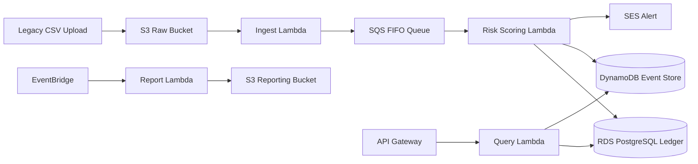

# FinTrust Bank SA - Transaction Insights and Risk Monitoring System

A capstone project for a cloud-native transaction insights and risk monitoring system for a South African fintech bank.

## Current Build Status

The repository currently includes the Week 13 Day 1-3 foundation and Day 4-5 design/tests: S3/IAM/SSM/DLQ/CloudWatch provisioning scripts, a PostgreSQL schema and seed set, a DynamoDB risk-score table, an S3-triggered CSV ETL handler, and local read-only API routes. The Day 2/3 ingest path writes valid rows directly from the Lambda to PostgreSQL. API Gateway/IAM route configuration, the separate SQS FIFO scoring path, risk-score writer, SES alerting, EventBridge reporting, live PostgreSQL checks, and deployment evidence remain to be completed or deployed.

## Business Outcome

FinTrust needs a system that can:
- ingest transaction data from legacy sources,
- validate and risk-score each transaction,
- store an auditable ledger and event log,
- surface compliance insights through a secure API,
- alert the risk team when a transaction exceeds policy thresholds,
- produce monthly executive reporting.

The solution is built around the AWS Free Tier and follows the FinTrust capstone brief: a serverless ingestion path, SQL-backed ledger, NoSQL event log, API access for analysts, and automated reporting.

## Architecture Summary



## Folder Structure

```text
fintrust/
  __init__.py
  config.py
  db.py
  dynamo.py
  models.py
  validators.py
  ingest.py
  score.py
  alert.py
  query.py
  report.py
  api.py

sql/
  schema.sql
  seed.sql
  risk_report.sql
  monthly_summary.sql
  views.sql
  procedure.sql

infrastructure/
  README.md
  s3/
  iam/
  ssm/
  dynamodb/
  sqs/
  monitoring/

tests/
  conftest.py
  test_validators.py
  test_score.py
  test_ingest.py
  test_api.py
  data_quality/

.github/
  workflows/
    ci.yml

docs/
  architecture.md
  erd.md
  api_design.md
  data_governance.md
  iam_role_matrix.md
  day3_resilience.md
  rubric_checklist.md

project-reference/
  HANDOFF.md
  README.md
  component_guide.md
  completed_work.md
  remaining_work.md
  local_software_setup.md
  live_demo_script.md
  presentation_notes.md

samples/
  transactions_day2.csv
```

## Core Principles

1. Least privilege first: Lambda execution roles are minimal and purpose-specific.
2. Data quality before storage: validation happens before persistence.
3. Event-driven processing: ingestion is decoupled from scoring and alerting.
4. Compliance by design: POPIA-conscious data handling and retention logic are part of the design.
5. Operational trust: logs, metrics, and alerts are included in the architecture.

## Deployment Story

This solution is intended to be explained as a business-grade financial controls platform:
- raw transaction files land in S3,
- validation confirms format and business rules,
- risk scoring calculates a transaction risk profile,
- suspicious events are reviewed by compliance teams,
- management receives monthly trend analysis.

## How to Present It Confidently

When speaking to stakeholders:
- describe the business problem before the architecture,
- explain why each AWS service was chosen,
- connect every technical decision to a business outcome,
- be ready to answer what happens when a transaction fails validation or when a Lambda errors,
- show the security and compliance logic, not just the happy path.

## Suggested Presentation Narrative

- Problem: FinTrust needs a faster, safer way to detect risk in high-volume banking transactions.
- Solution: Serverless event-driven analytics and risk-monitoring pipeline.
- Why this works: real-time validation, asynchronous processing, governance controls, auditable events.
- Business value: reduced fraud exposure, lower manual review burden, improved compliance posture.

## Quick Start

```bash
python -m venv .venv
.\.venv\Scripts\activate
pip install -r requirements.txt
Copy-Item .env.example .env
python -m pytest -q
```

Set local database and AWS values in `.env` for your machine; `.env` is ignored by Git. The PostgreSQL constraint tests skip unless `FINTRUST_TEST_DATABASE_URL` points to a disposable test database. Run the local API with `python -m fintrust.api` and use `http://127.0.0.1:5000/v1/health`.

## Notes

AWS infrastructure scripts create real account resources when explicitly run. Review `infrastructure/README.md` and AWS costs/permissions before running them. Local tests use Moto and do not deploy AWS resources.
