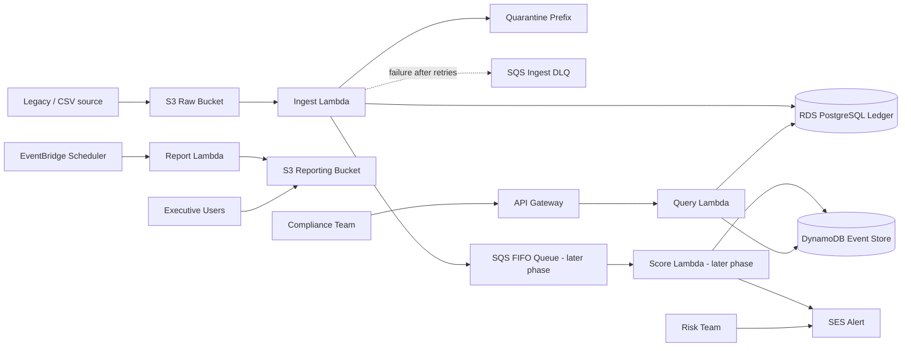

# FinTrust Cloud Architecture

## Implementation Status

The diagram below is the capstone target architecture. The repository now includes Day 1-3 provisioning/application code for S3 ingest, PostgreSQL loading, an ingest DLQ and CloudWatch alarms, plus local read-only API routes. The Week 13 Day 2/3 exercise uses direct S3-to-Lambda-to-RDS ingestion; SQS FIFO scoring is a later capstone evolution. The score writer, SES alerting, EventBridge reporting, and deployed API Gateway/dashboard still need implementation or AWS deployment. Treat a component as live only after the AWS resource and end-to-end behavior have been verified.

## 1. System Context

FinTrust Bank SA processes incoming transaction records from legacy systems and external sources, validates them for business correctness, and scores each transaction for risk. The platform is designed to detect unusual activity, protect sensitive financial data, and support compliance reporting for fraud and risk teams.

## 2. Target Architecture

## 3. Design Rationale

### S3
- Raw transaction uploads enter through S3.
- This is a low-friction ingestion point for CSV files from legacy banking systems.
- It also supports quarantine and audit-friendly storage patterns.

### Lambda
- Lambda functions handle validation, scoring, API queries, and scheduled reporting.
- They are serverless and scale to transaction volume without a dedicated fleet.
- Each function has a single purpose and clear permissions.

### SQS FIFO
- SQS decouples ingestion from scoring.
- FIFO preserves transaction order by account.
- It supports retries and dead-letter paths when processing fails.

### RDS PostgreSQL
- The relational ledger supports financial records, account associations, and analytics queries.
- Normalised tables make reconciliation and reporting easier.
- The financial data model is suitable for compliance and audit needs.

### DynamoDB
- DynamoDB stores event metadata, risk information, and fast lookup records.
- It complements the ledger with a low-latency operational view.

### API Gateway
- The compliance team can query transactions and insights through a secure interface.
- The Day 4 design uses AWS_IAM authorization for data routes; the health endpoint exposes status only.

### SES
- High-risk transactions trigger alerts without requiring broad operational monitoring.

### EventBridge + report Lambda
- Monthly reporting is automated and scheduled.
- Management receives summary output without manual extraction work.

## 4. Security and Free Tier Considerations

- RDS is restricted to private network access.
- Lambda execution roles are least-privilege.
- No NAT Gateway is used, to avoid unnecessary cost.
- The design stays within the capstone's Free Tier assumptions and keeps the architecture cost-conscious.

## 5. Failure Handling

- The current ingest path validates rows before storing them; invalid rows go to S3 quarantine.
- Invocation-level failures are retried and then sent to the configured SQS dead-letter queue.
- The FIFO scoring queue is part of the later end-to-end capstone architecture, not the current Day 3 direct-load path.
- Risk events and transaction metadata remain recoverable through logs and data retention.

## 6. Presentation Narrative

When presenting, explain the architecture as a business control loop:

1. Data enters the bank.
2. It is checked for quality and risk.
3. It is processed asynchronously.
4. The business receives alerts and insights.
5. Monthly reporting supports executive decision-making.
