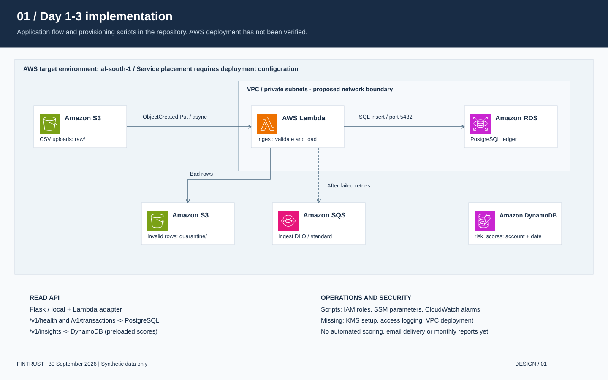
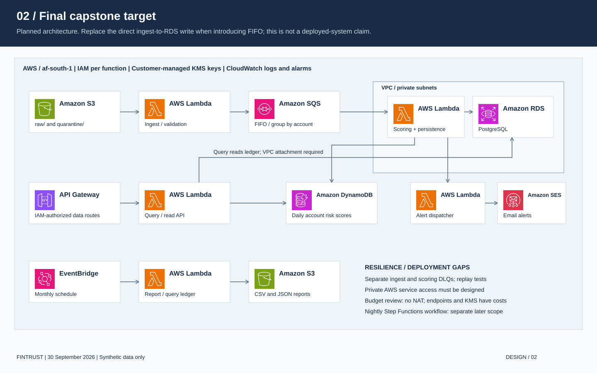

# Architecture

The diagrams use official AWS service icons. Open the [three-page PDF](../output/pdf/fintrust_architecture_and_erd.pdf) for presentation or the [draw.io source](diagrams/fintrust.drawio) to edit them.

## Current Day 1-3 flow

The S3 event handler validates each file, writes good rows directly to PostgreSQL, and quarantines bad rows in S3. Infrastructure scripts describe the asynchronous ingest DLQ and monitoring setup. The local read API queries PostgreSQL transactions and preloaded DynamoDB scores. Deployment has not been verified.

## Final target

The final brief adds a per-account FIFO queue, scoring and persistence, SES alerts, API Gateway, and scheduled reports. When that pipeline is implemented, replace the direct ingest write deliberately; avoid two independent ledger writers. The standard ingest DLQ and a FIFO scoring DLQ serve different failure paths.

## Decisions and deployment boundaries

Lambda suits short event-triggered tasks. PostgreSQL supplies relationships and constraints; DynamoDB supplies the account/date score lookup. S3 retains source files and quarantine evidence. Service separation makes failures easier to diagnose, but each boundary needs retry and duplicate-handling tests.

RDS must be private. Lambda functions accessing it need VPC attachment and a security group path to port 5432. These same functions also need connectivity to S3, SSM, DynamoDB and any other AWS APIs they call. Omitting a NAT Gateway does not provide that connectivity automatically. Endpoint selection, endpoint policies, Lambda VPC permissions, DNS and cost must be resolved before deployment. The diagrams show intended placement, not provisioned networking.

Customer-managed KMS encryption, access logging to a separate bucket, SQL users/grants, and deployed security evidence remain incomplete. The current database helper opens a fresh connection for each call; connection reuse and concurrency limits still need work.

Cost eligibility depends on the training account and configured services. Budget evidence must replace assumptions from the course's Free Tier table. Large files currently load into memory and need a documented limit or a chunked workflow.

Source: [AWS architecture icons](https://aws.amazon.com/architecture/icons/), July 2026 release. Asset attribution and rebuild instructions: [diagram README](diagrams/README.md).
