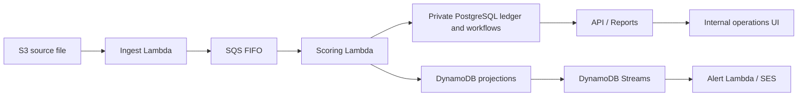
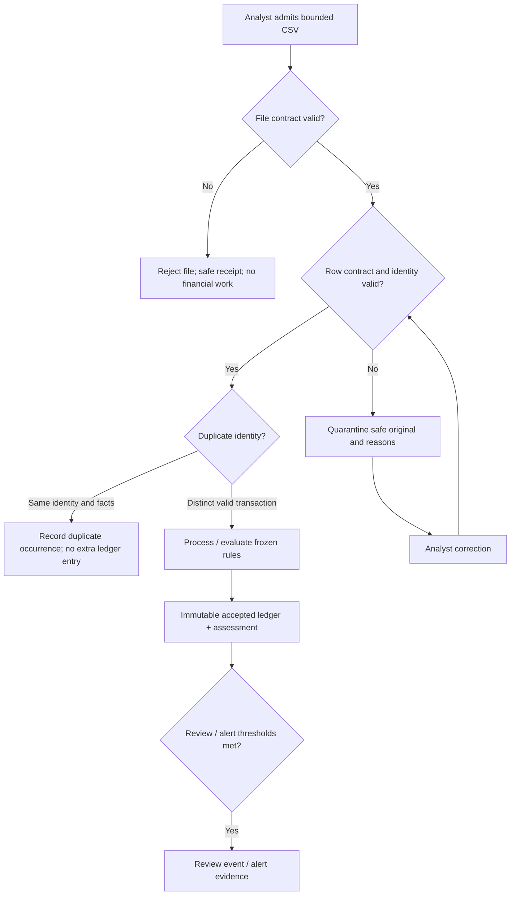
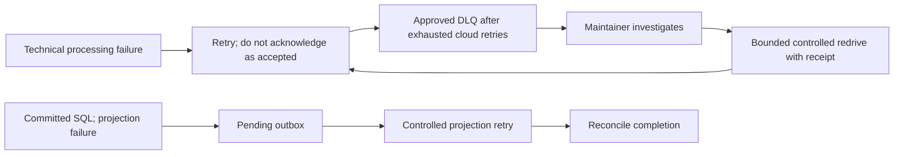
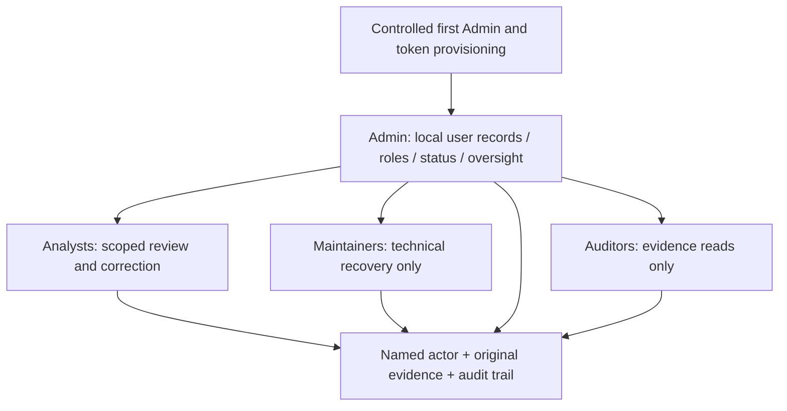

# Current Release 1 presentation diagrams

These views distinguish implemented local behavior from the AWS target. Existing historical SVG/PDF exports are not proof of live integration. The local UI uses real isolated PostgreSQL with mocked S3/DynamoDB; it does not run the cloud FIFO/Streams/SES chain.

## Architecture: AWS target, integration incomplete

Infrastructure stages 1–4 were verified previously. This local audit does not claim the complete application chain is live; live public schema bootstrap remains pending after read-only preflight.

## Actual local data decisions

High risk is an accepted valid transaction with an assessment, not invalid data. Review and alert thresholds follow current rules; do not claim that every Low/Medium event is an alert.

## Failure and recovery

Cloud DLQ/provider delivery is a separately approved integration. Local tests inject failures and verify pending work, retries and receipts; a queued recovery request is not a success claim.

## Users and separation of duties

Arrows to roles represent access governance, not permission inheritance. Admin cannot make routine risk decisions; Maintainer cannot bypass quarantine; Auditor cannot mutate. Multiple people may hold each role. Local records are not enterprise SSO.
