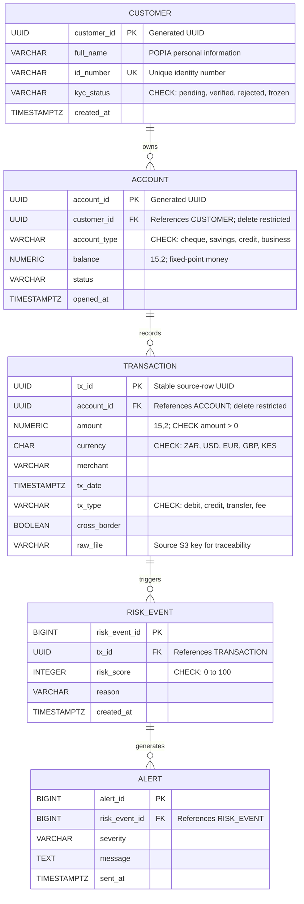

# FinTrust Entity Relationship Diagram

Presentation exports: [ERD SVG](diagrams/erd.svg), [editable draw.io](diagrams/fintrust.drawio), and [PDF, page 3](../output/pdf/fintrust_architecture_and_erd.pdf).

This ERD matches `sql/schema.sql`. UUIDs identify business entities; transaction amounts use fixed-precision numeric types; the foreign keys preserve ledger history.

## Entity Data Dictionary and Rules

| Entity | Key fields and types | Business rule / reason |
|---|---|---|
| `customers` | `customer_id UUID PK`, `full_name VARCHAR(150)`, `id_number VARCHAR(20) UNIQUE`, `kyc_status VARCHAR(20)`, `created_at TIMESTAMPTZ` | KYC is a finite state (`pending`, `verified`, `rejected`, `frozen`); a check constraint prevents unrecognised states. Full name and identity number are personal information and must be access-controlled. |
| `accounts` | `account_id UUID PK`, `customer_id UUID FK`, `account_type VARCHAR(30)`, `balance NUMERIC(15,2)`, `status VARCHAR(20)`, `opened_at TIMESTAMPTZ` | Account types are constrained to the agreed set. `NUMERIC`, not floating point, avoids rounding errors in balances. Deleting a customer with accounts is restricted. |
| `transactions` | `tx_id UUID PK`, `account_id UUID FK`, `amount NUMERIC(15,2)`, `currency CHAR(3)`, `tx_date TIMESTAMPTZ`, `tx_type VARCHAR(30)`, `cross_border BOOLEAN`, `raw_file VARCHAR(200)` | Amount is positive; direction is represented by `tx_type`, avoiding negative transaction amounts. Currency and type are constrained. `raw_file` traces a ledger row to its input object. Accounts with transactions cannot be deleted. |
| `risk_events` | `risk_event_id BIGSERIAL PK`, `tx_id UUID FK`, `risk_score INTEGER`, `reason VARCHAR(255)`, `created_at TIMESTAMPTZ` | A score must be in the range 0–100. Risk decisions are kept apart from the financial transaction record. |
| `alerts` | `alert_id BIGSERIAL PK`, `risk_event_id BIGINT FK`, `severity VARCHAR(20)`, `message TEXT`, `sent_at TIMESTAMPTZ` | An alert is linked to the risk event that caused it, preserving investigation context. |

## Relationships and Normalisation

- One customer can own many accounts; each account belongs to one customer.
- One account can have many transactions; each transaction belongs to one account.
- One transaction can have multiple risk events; each risk event refers to one transaction.
- One risk event can have multiple alerts; each alert refers to one risk event.
- Customer attributes are stored once rather than repeated on accounts or transactions. Risk-event and alert attributes are stored separately from the ledger. This reduces update anomalies and keeps the core model in third normal form for these stated dependencies.

## Indexes

- `idx_tx_account_date` supports account transaction history sorted newest first.
- `idx_tx_high_amount` is a partial index for transactions over R50,000.
- `idx_tx_crossborder` is a partial index for cross-border compliance queries.
- `idx_risk_events_tx_date` supports risk-event history by transaction.
