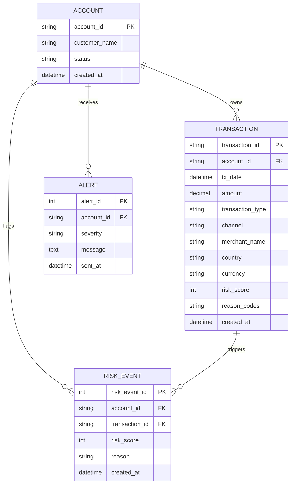

# FinTrust Entity Relationship Diagram

## 1. ERD Overview

## 2. Normalisation Notes

The schema follows a 3NF approach:
- Accounts are stored once in the accounts table.
- Transactions reference the account through a foreign key.
- Risk events are separate from the transaction ledger so that risk metadata is not mixed into the core transaction record.
- Alerts are stored separately to support operational monitoring and compliance records.

## 3. Data Relationships

- One account may have many transactions.
- One transaction may trigger one or more risk events.
- One account may have many alerts.
- Alerts and risk event records are operational artefacts, while the transactions table is the main ledger.

## 4. Why this structure matters to the business

This model helps FinTrust answer practical questions reliably:
- Which customer is associated with a suspicious payment?
- How many high-risk transactions occurred in a time window?
- Which alerts were raised for a given account?
- Which records need review by the compliance team?
